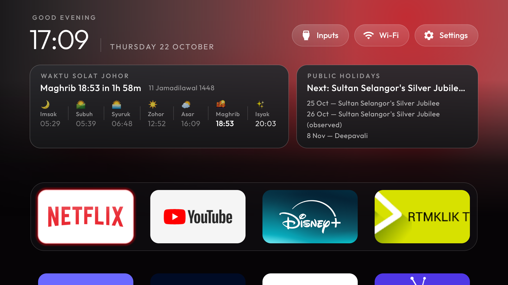
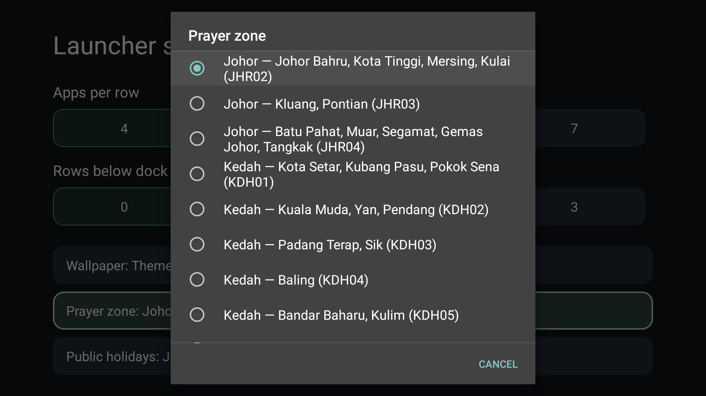
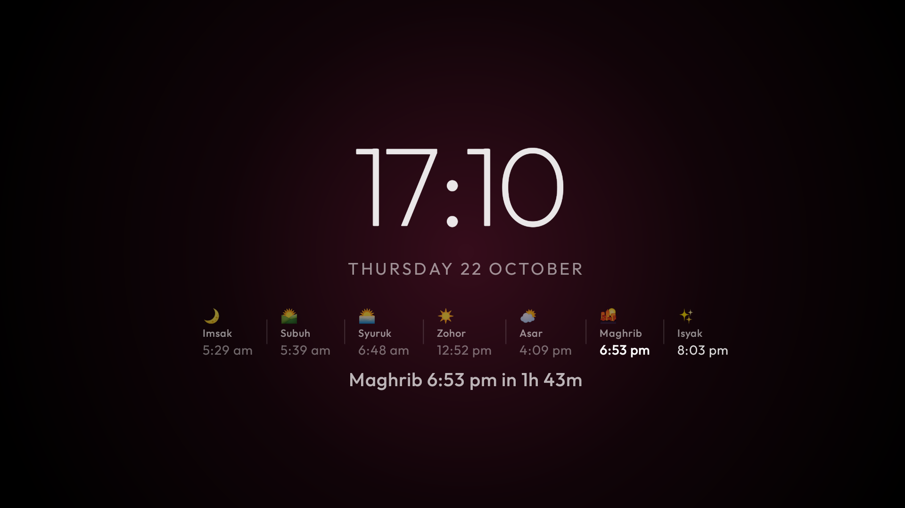
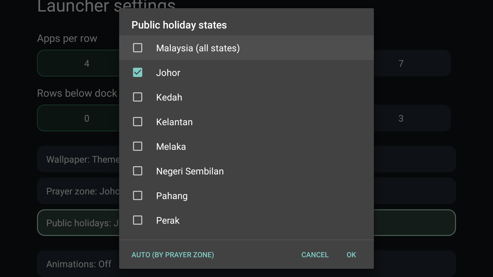

# Added features (this fork)

This is a fork of [Gathin23/cleanyourtv](https://github.com/Gathin23/cleanyourtv) (MIT licensed —
see [LICENSE](LICENSE)). Everything in the base project (debloat, the launcher, themes, tools)
works as documented in the main [README.md](README.md). This file covers only what was added on
top, for a Malaysia-focused Android TV setup: a prayer-times card, a public-holidays card, a
Continue Watching row, a cinematic per-app backdrop, and a prayer-times screensaver — all
configurable per TV, not hardcoded to one state.

**Important: installing the launcher APK does not debloat the TV.** They are two separate steps.
The APK only replaces Home with this launcher. Debloating (disabling the manufacturer's telemetry,
ads and preloaded junk) is `tools/disable.sh` against an `examples/<your-tv>/debloat.txt` list, run
once over ADB before or after installing the launcher. See "Manual setup, step by step" below.

## 1. Waktu Solat (prayer times) card + screensaver

A card on Home showing the zone's name, the next prayer with a live countdown, the Hijri date, and
a 7-column table (Imsak, Subuh, Syuruk, Zohor, Asar, Maghrib, Isyak) with icons. The current/next
prayer is bold (gold inside 15 minutes); already-passed entries are dimmed. The same table and
countdown also appear on the clock screensaver (`ClockDream`/`ClockActivity`), centred on screen
with a few pixels of jitter each minute so nothing burns in — on by default whenever the Prayer
card is on, no separate switch.





- **API**: [api.waktusolat.app](https://api.waktusolat.app) (`mptwaktusolat/api-waktusolat` on
  GitHub) — official JAKIM data, no key needed.
  - `GET /v2/solat/{zone}` — a month of prayer times for a JAKIM zone code (e.g. `JHR02`).
  - `GET /zones` — the full list of 60 JAKIM zones, states and districts (bundled into
    `JakimZones.java` rather than fetched, since it essentially never changes).
- **Location**: **not auto-detected.** There's no GPS on a TV box. The zone is a manual picker —
  **Launcher settings (hold OK on the Settings pill) → Prayer zone** — listing all 60 zones; it
  defaults to `prayer_zone` in `config.xml` (`JHR02`) until changed. Data is fetched once a day and
  cached in SharedPreferences; the on-screen countdown just ticks locally the rest of the time.
- **Code**: `PrayerTimes.java` (fetch/cache/next-prayer logic), `JakimZones.java` (zone list +
  zone→state mapping for the holidays card), `MainActivity.updatePrayerPanel()` and
  `ClockScene.updatePrayer()` (display, identical highlight logic in both places),
  `LauncherSettingsActivity.showPrayerZonePicker()` (the picker UI).

## 2. Public Holidays card

A second card, same visual style, showing today's status (if today is a holiday), the next
upcoming one, and every holiday in the current and next calendar month.

- **API**: [mycal-api.huijun00100101.workers.dev](https://mycal-api.huijun00100101.workers.dev)
  (`Junhui20/malaysia-calendar-api` on GitHub) — no key needed.
  - `GET /v1/holidays?year=YYYY&state=SLUG&month=M` — holidays for one state.
  - `GET /v1/holidays?year=YYYY` (no `state`) — the full master list, every state's holidays plus
    federal ones, in one request. Used for the "Malaysia (all states)" picker option.
- **State selection — Launcher settings → Public holiday states**: a multi-select picker, all 16
  Malaysian states/territories plus a **"Malaysia (all states)"** entry. Checking "Malaysia"
  un-checks and locks out the individual states (it already covers them); checking any individual
  state un-checks "Malaysia". A **neutral "Auto" button** clears the on-TV choice, falling back to
  the Prayer zone's own state plus an optional `extra_holiday_states` theme key (comma list, e.g.
  `"selangor,kuala-lumpur"`) for a build-time default covering more than one state.
- **Manual override**: `Holidays.addManualOverrides()` has one hardcoded entry (Selangor's Sultan
  Sharafuddin Silver Jubilee, Oct 2026) for a holiday gazetted too recently for the open data
  source to carry yet. Remove it once upstream catches up, or add your own the same way for a
  similar situation.
- **Code**: `Holidays.java`, `LauncherSettingsActivity.showHolidayStatesPicker()`.



## 3. Continue Watching row

A decorative (non-focusable) horizontal row of posters, pulling from Android's own Watch Next
system — the same mechanism the stock Android TV launcher uses for its "Play Next" row.

- **API**: `android.media.tv.TvContract.WatchNextPrograms` (part of the Android framework, API 26+,
  no special permission needed to read it). Filtered to Netflix, YouTube and Disney+ package names
  only; any app that already publishes to this table (most big streaming apps do, since it's the
  standard home-screen integration point) will show up once it has something in progress.
- Empty until you've actually watched something in one of those apps — there's nothing to show
  otherwise. Not clickable in this version (resuming playback via the stored intent would need
  wiring into the focus-navigation system).
- **Code**: `WatchNext.java`, `MainActivity.showWatchNext()`.

## 4. Cinematic backdrop per focused app

Not new code — this turns on two settings the base launcher already ships (both off by default):
`cinematic_home` (the focused dock app's own icon/banner, heavily downscaled then stretched
full-screen, which blurs it without the cost of a real blur) and `dock_title: false` (hides the big
app-name-and-dots row that `cinematic_home` would otherwise show above the dock, so the background
changes without eating the vertical space other app rows need). Deliberately **not** downloaded
artwork — using the app's own already-installed icon avoids any copyright question around bundling
or fetching official promotional art.

## Settings summary (Launcher settings, hold OK on the Settings pill)

| Row | What it does |
|---|---|
| Prayer zone | Pick your JAKIM zone from all 60; sets the Waktu Solat card and screensaver |
| Public holiday states | Multi-select states for the Holidays card, or "Malaysia (all states)" |
| (existing rows: Apps per row, Edit dock, Wallpaper, Animations, …) | Unchanged from the base project |

## Tools needed to build/modify this launcher

- **JDK 17** (e.g. Eclipse Temurin)
- **Android SDK**: `platform-tools`, `platforms;android-34`, `build-tools;34.0.0`
- **Python 3** (for `tools/tv.py`, `disable.sh`, `theme.sh`, etc. — the base project's own tooling)
- **adb**, on the machine building/installing, with the TV on the same Wi-Fi network and USB/Network
  debugging enabled on the TV (Settings → Device Preferences → About → tap Build 7×, then
  Developer options)

## Manual setup, step by step

```bash
git clone <your-fork-url>
cd cleanyourtv
python3 -m venv tools/venv
tools/venv/bin/pip install -r tools/requirements.txt   # tools/venv/Scripts on Windows

# Find the TV's IP in TV Settings → Network, then on the TV: Developer options → USB debugging on
export TV_HOST=<tv-ip>

# One-time: probe the TV, accept the "Allow USB debugging" prompt it shows
tools/venv/bin/python -I tools/tv.py --probe

# Debloat — a SEPARATE step from installing the launcher. Pick the closest
# examples/<your-tv-model>/debloat.txt, or write your own by copying an existing one.
bash tools/disable.sh examples/<your-tv>/debloat.txt

# Build and install the launcher itself (needs JAVA_HOME and ANDROID_HOME set)
cd launcher
bash build-and-install.sh
```

The install script needs the TV to settle on this launcher as Home; if the TV has another app
(or more than one) also registering for Home, Android shows a chooser — pick this launcher and
choose **Always**. This can recur after a reboot or reinstall on some TVs (it did on the one this
fork was built for) since Android re-validates that choice against the current set of competing
apps; just repeat the same pick each time it happens.

**To update the launcher after a code change** (no need to redo debloat): just re-run
`bash build-and-install.sh` from `launcher/`. It rebuilds and reinstalls over the existing app,
keeping your on-TV settings (Prayer zone, Holiday states, dock order) — reinstalling an Android app
over itself does not reset its data.

**To push a config change** (the Prayer zone default, `extra_holiday_states`, `cinematic_home`,
`dock_title`, etc.) **without rebuilding**: edit a theme's `config.json` (see `themes/mytv/` in this
fork for a working example) and push it:

```bash
TV_HOST=<tv-ip> tools/theme.sh themes/<your-theme>
```

Note: reinstalling the APK (`build-and-install.sh`) does **not** clear a pushed theme (it lives in
the app's external files, separate from the APK) — but `pm clear` or an uninstall does, so re-push
the theme if you ever do either of those.

## Restoring the TV

```bash
TV_HOST=<tv-ip> tools/restore.sh examples/<your-tv>/debloat.txt
```

## Forking and contributing back

1. Use GitHub's own **Fork** button on
   [Gathin23/cleanyourtv](https://github.com/Gathin23/cleanyourtv) — this is the cleanest way to
   publish: GitHub automatically shows "forked from Gathin23/cleanyourtv" on your repo page, and
   keeps a traceable relationship for later pull requests.
2. Add this fork as a remote and push your work:
   ```bash
   git remote set-url origin https://github.com/<you>/<your-repo-name>.git
   git add -A
   git commit -m "Add Waktu Solat, Public Holidays, Continue Watching and cinematic backdrop"
   git push -u origin main
   ```
3. **Contributing a general-purpose piece back upstream**: the base project explicitly welcomes
   this (see its `CONTRIBUTING.md` and the `SHOWCASE.md` "Forks of the launcher" list, which lists
   dozens of community forks). Good candidates to upstream from this fork, since they're not
   Malaysia-specific in mechanism:
   - The Continue Watching row (`WatchNext.java`) — the Watch Next API works for any region.
   - The cinematic-backdrop pairing of `cinematic_home` + `dock_title: false` is arguably a
     one-line docs fix upstream, not a code change.
   - The Prayer-time and Public-Holiday cards are Malaysia-specific (JAKIM zones, a Malaysia
     holidays API) — these fit better as a `SHOWCASE.md` entry for your own fork than as an
     upstream PR, the same way the showcase already lists `Afnon` (Arabic prayer times) as its own
     project rather than a merged feature.
   Open a PR against `Gathin23/cleanyourtv` for anything you do want to upstream, same as any other
   GitHub project; the project's `CONTRIBUTING.md` has its testing/PR conventions.

### Suggested repo names

- `cleanyourtv-my` — short, signals "Malaysia", matches the `.my` ccTLD convention
- `cleanyourtv-waktu-solat` — descriptive, leads with the headline feature
- `CleanTV-Malaysia`
- `my-cleanyourtv`

## Screenshots

All captured directly from the TV over ADB: `docs/my-home.png` (Home, with both cards and the
dock), `docs/my-prayer-zone-picker.png` and `docs/my-holiday-states-picker.png` (the two Launcher
settings dialogs), and `docs/my-screensaver.png` (the clock screensaver). Embedded above, next to
the feature each one shows.
